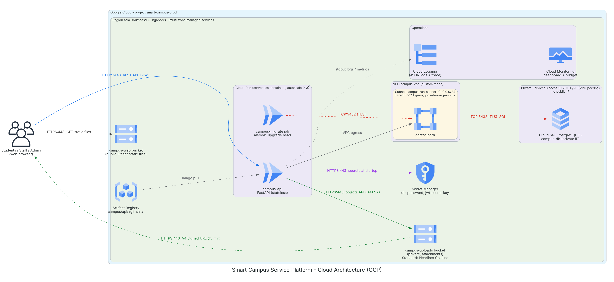
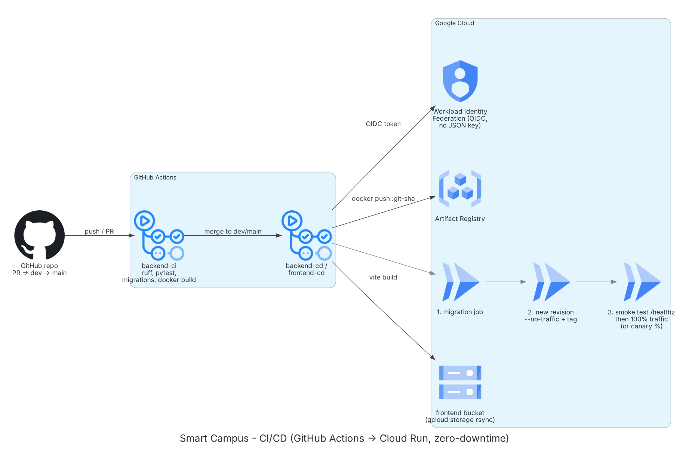

# Smart Campus — Cloud Design & Justification

เอกสารนี้ผูกการออกแบบระบบเข้ากับเนื้อหาที่เรียน (บทที่ 1–8) และเกณฑ์ให้คะแนน
ใช้เป็นฐานทำสไลด์นำเสนอและเตรียมถาม–ตอบ ส่วนขั้นตอนติดตั้งจริงอยู่ใน [DEPLOYMENT.md](../DEPLOYMENT.md)

แผนภาพสร้างจากโค้ดใน [`architecture/diagram.py`](architecture/diagram.py) ด้วยไอคอนทางการของ GCP
ขอบเขตซ้อนกันเป็น Provider → Region → VPC → Subnet และทุกลูกศรมีโปรโตคอลกับพอร์ต (บทที่ 8)
ไลบรารีไม่มีไอคอน Secret Manager กับ Artifact Registry จึงใช้ไอคอน KMS กับ Container Registry แทน
ถ้าต้องการไอคอนตรงทุกตัว ให้เปลี่ยนสองตัวนี้ใน draw.io

---

## 1. ภาพรวมและการจัดประเภท

| หัวข้อ | คำตอบของโปรเจกต์ | บทที่ |
|---|---|---|
| Deployment model | **Public cloud** (Google Cloud, project เดียว, region `asia-southeast1`) | 2, 3, 5 |
| Service model | Cloud Run = **serverless containers** (คาบเกี่ยว PaaS/CaaS: เราส่ง container, Google ดูแล OS, runtime, scaling), Cloud SQL = **managed database (PaaS)**, Cloud Storage = **object storage** | 2, 3 |
| Application pattern | **3-Tier + Modular Monolith** (React → FastAPI → PostgreSQL) | 7 |
| Migration strategy (6 Rs) | **Replatform** — monolith ใส่ container, ย้าย state ไป managed DB และ object storage ไม่ได้แตกเป็น microservices | 8 |

### Shared Responsibility Model (บทที่ 3, 5)

| ชั้นของ cloud stack | Google ดูแล | ทีมเราดูแล |
|---|---|---|
| Data center, server, network กายภาพ | ✅ | |
| Virtualization / hypervisor / container runtime | ✅ | |
| OS และ patch | ✅ (Cloud Run, Cloud SQL) | |
| Runtime (Python) และ dependency | | ✅ (`Dockerfile`, `requirements.txt`) |
| Application code, การตรวจสิทธิ์ | | ✅ |
| ข้อมูล, การตั้งค่า IAM, network rule, secret | | ✅ |
| Backup อัตโนมัติ, replication ของ storage | ✅ (เราตั้งค่า retention) | |

---

## 2. เหตุผลการเลือกแต่ละบริการ (What / Role / Why + Trade-offs)

รูปแบบตามบทที่ 8 สไลด์ 34: บริการคืออะไร, ทำหน้าที่อะไรในระบบเรา, ทำไมเลือกแทนทางเลือกอื่น

| บริการ | What it is | Role ในระบบ | Why this (แทนอะไร และเสียอะไร) |
|---|---|---|---|
| **Cloud Run** | รัน container แบบ serverless, scale 0→N ตาม request | รัน FastAPI (`campus-api`) และ migration job | แทน **Compute Engine (VM)**: ไม่ต้องดูแล OS, scale อัตโนมัติ, scale-to-zero จ่ายเฉพาะตอนมี request (ค่า compute ~$0 ในโควตาฟรี) · แทน **GKE**: ไม่ต้องดูแล cluster ซึ่งเกินจำเป็นสำหรับ 1 service · แทน **Cloud Functions**: ระบบเป็น API ทั้งชุดที่ต้องการ transaction และ connection pool ไม่ใช่งาน event สั้น ๆ · เสีย: cold start ~1–2 วินาทีหลังว่างนาน (หน้าเว็บแสดงสถานะ "waking up" แล้วลองใหม่; วันสาธิตใช้ `ops.sh warmup prod on` เพื่อตั้ง min-instances=1) |
| **Cloud SQL for PostgreSQL** | Relational DB แบบ managed (backup, patch, failover ให้) | เก็บผู้ใช้ คำร้อง การจอง การแจ้งเตือน | ระบบจองต้องการ **ACID**, row lock (`SELECT ... FOR UPDATE`) และ exclusion constraint กันเวลาทับ ซึ่ง **Firestore/NoSQL** (BASE, eventual consistency) ทำไม่ได้ตรง ๆ · แทนการลง PostgreSQL บน VM: ไม่ต้องทำ backup/patch เอง · แทน **Spanner**: แพงเกินงบมาก · เสีย: ค่าใช้จ่ายคงที่รายชั่วโมง (~$9–10/เดือน) เป็นก้อนใหญ่สุดของระบบ |
| **Cloud Storage** (2 bucket) | Object storage, เข้าถึงผ่าน HTTPS API, durability 11 nines | `campus-uploads` (private) เก็บไฟล์แนบ, `campus-web` (public) เก็บไฟล์ React | ไฟล์แนบเป็นข้อมูลไม่มีโครงสร้าง อ่านทั้งไฟล์ทีละครั้ง จึงเหมาะกับ **object storage** มากกว่า **Filestore (file/NFS)** ที่แพงกว่ามากและต้องผูกกับ VM หรือ **Persistent Disk (block)** ที่ผูกกับเครื่องเดียว ทำให้ container ไม่ stateless · เปิดไฟล์ผ่าน V4 Signed URL 15 นาที จึงไม่ต้องเปิด bucket สาธารณะ |
| **VPC + Direct VPC Egress** | เครือข่ายส่วนตัว + ให้ Cloud Run ส่ง traffic เข้า VPC ได้โดยตรง | ทางเดียวที่ API คุยกับ DB (private IP) | แทน **Serverless VPC Access connector** ใน proposal: ไม่มี VM ของ connector ที่คิดเงินตลอดเวลา และ scale ตาม service · ตั้ง `private-ranges-only` จึงไม่ต้องมี **Cloud NAT** (~$32/เดือนตามบทที่ 8) |
| **Secret Manager** | ที่เก็บ secret พร้อม version และ IAM | `db-password`, `jwt-secret-key` ส่งเข้า container เป็น env ตอนเริ่ม | ตาม 12-Factor III: ไม่มีรหัสผ่านใน Git, image หรือ GitHub · แทน env var ธรรมดา: มี version, audit, จำกัดสิทธิ์อ่านราย service account |
| **Artifact Registry** | ที่เก็บ Docker image | เก็บ `campus/api:<git-sha>` | แทน Container Registry (`gcr.io`) ที่ปิดตัวแล้ว · tag ด้วย git sha ทุก image ย้อนกลับหา commit ได้ · cleanup policy เก็บ 10 image ล่าสุด |
| **GitHub Actions + Workload Identity Federation** | CI/CD + การยืนยันตัวตนด้วย OIDC token อายุสั้น | test → build → migrate → deploy อัตโนมัติ | แทน Cloud Build: โค้ดอยู่ GitHub อยู่แล้ว · WIF แทน JSON key: ไม่มี credential ถาวรที่รั่วได้ |
| **Cloud Logging / Monitoring / Trace** | Observability ที่มากับ Cloud Run | log JSON, dashboard, budget alert | ไม่ต้องติดตั้ง Prometheus/ELK เอง (บทที่ 7) |

### สิ่งที่ตั้งใจไม่ใช้ (เตรียมตอบกรรมการ)

| ไม่ใช้ | เหตุผล |
|---|---|
| **Load Balancer / API Gateway** | Cloud Run มี HTTPS endpoint และกระจาย request ข้าม instance ให้เองอยู่แล้ว · หน้าที่ของ API Gateway (auth, rate limit, routing) ทำในแอป เพราะมี service เดียว · LB เริ่มคุ้มเมื่อต้องการ custom domain หลาย service หรือ **Cloud Armor (WAF)** ซึ่งเกินงบ |
| **Microservices / Kubernetes** | ทีม 2 คน เวลา 7 สัปดาห์ · monolith แบ่งโมดูลชัด (Router → Service → Model) แยกเป็น service ทีหลังได้ · microservices เพิ่มความซับซ้อนเรื่อง network, data consistency, tracing (บทที่ 7) |
| **Message queue (Pub/Sub)** | แจ้งเตือนเป็น in-app และสร้างใน transaction เดียวกับการเปลี่ยนสถานะ จึงไม่ต้อง decouple · ถ้าเพิ่มอีเมลแจ้งเตือนภายหลัง ควรส่งผ่าน Pub/Sub หรือ Cloud Tasks |
| **Memorystore (Redis)** | ไม่มี session state (ใช้ JWT) จึงไม่ต้องมี cache สำหรับ state |

---

## 3. Storage และข้อมูล (บทที่ 6)

| คำถาม | การออกแบบ |
|---|---|
| Block / File / Object? | ข้อมูลธุรกรรม → Cloud SQL (ใต้ฐานเป็น block storage SSD ที่ Google ดูแล) · ไฟล์แนบ/ไฟล์ static → **object storage** · ไม่มีงานที่ต้องการ file storage แบบแชร์ |
| OLTP หรือ OLAP? | **OLTP** — ธุรกรรมเล็ก ถี่ ต้อง latency ต่ำ → relational DB · สถิติใน dashboard เป็น aggregate query บนตารางเดียวกัน ยังไม่ถึงขั้นต้องแยก data warehouse |
| ACID หรือ BASE / CAP? | **ACID** · การจองต้อง consistent ทันที (ห้ามสองคนได้ห้องเดียวกัน) จึงเลือกฝั่ง **C** ของ CAP: ถ้า DB ไม่พร้อม API ตอบ error แทนการตอบข้อมูลเก่า |
| Storage tiering / lifecycle | bucket ไฟล์แนบมี lifecycle: Standard → **Nearline** หลัง 30 วัน → **Coldline** หลัง 180 วัน (คำร้องที่ปิดแล้วแทบไม่ถูกเปิด) · ไม่ตั้งลบอัตโนมัติ เพราะ DB ยังอ้างถึงไฟล์ |
| Availability vs Durability | Durability: GCS ออกแบบ 11 nines, Cloud SQL มี automated backup 7 ชุด + point-in-time recovery · Availability: ดูหัวข้อ 4 |

---

## 4. Reliability, Scalability และ Security

### Pre-submission checklist (บทที่ 8 สไลด์ 25)

| ข้อ | สถานะ |
|---|---|
| Region และ VPC ชัดเจน | ✅ `asia-southeast1`, `campus-vpc`, subnet `10.10.0.0/24`, PSA `10.20.0.0/20` |
| Database ไม่อยู่ใน public network | ✅ Cloud SQL ไม่มี public IP (`--no-assign-ip`) และบังคับ SSL |
| Multi-AZ (อย่างน้อย 2 zone) | ⚠️ Cloud Run และ Cloud Storage เป็นบริการ **regional** กระจายหลาย zone ให้เอง · **Cloud SQL เป็น zone เดียว** เพื่อคุมงบ · เปิด HA ได้ด้วย `infra/gcp/ops.sh db-ha on` (ต้องย้ายไป dedicated-core tier ค่าใช้จ่ายเพิ่มหลายเท่า แนะนำเปิดเฉพาะช่วงสาธิต) |

**การเทียบกับ public/private subnet แบบ AWS:** Cloud Run ไม่ได้อยู่ใน subnet แต่รันบน infrastructure ของ Google
และเปิดรับ HTTPS สาธารณะ (ทำหน้าที่เหมือน DMZ) ส่วน traffic ไป DB ออกผ่าน `campus-run-subnet` ด้วย Direct VPC Egress
และ DB อยู่ในเครือข่ายที่ peer กันโดยไม่มี public IP จึงเท่ากับ "DB ใน private subnet" ตามเกณฑ์

### Scalability

- Cloud Run autoscale ตาม concurrency (**20** request/instance, ไม่ใช่ 80) จาก 0 ถึง 3 instance (prod) โดยไม่ต้องตั้งกฎ CPU เอง
- จุดคอขวดคือ **connection ของ DB**: แต่ละ instance เปิดได้สูงสุด 5 (pool 3 + overflow 2) → prod 15 + dev 5 + job 1 ≈ 21 connection
  จึงต้องจำกัด `max-instances` และไม่ให้ concurrency สูงกว่า pool มาก (เดิม 80 ทำให้ request ค้างจนครบ `DB_POOL_TIMEOUT` แล้วเพิ่ง error)
  ถ้า pool เต็ม API ตอบ **503** ภายใน 10 วินาที และหน้าเว็บลองใหม่เอง · ถ้าต้องรับโหลดมากขึ้น ขยับ tier ของ Cloud SQL หรือเพิ่ม connection pooler
- ทดสอบได้ด้วย `backend/scripts/loadtest.py` แล้วดูจำนวน instance ใน dashboard

### Resiliency patterns (บทที่ 7)

| Pattern | ใช้ที่ไหน |
|---|---|
| Health check | `/healthz` (startup probe ไม่แตะ DB), `/readyz` (ตรวจ DB) |
| Rate limiting | `POST /auth/login` 5 ครั้ง/นาที/IP |
| Retry / self-healing | `pool_pre_ping` ตัด connection ที่ตายแล้วต่อใหม่ · Cloud Run สร้าง instance ใหม่แทนตัวที่ล้มเอง · GCS client retry ให้ในตัว · หน้าเว็บ retry GET เมื่อเจอ cold start / 503 และไม่ล้าง session ถ้าเซิร์ฟเวอร์ยังไม่ตอบ |
| Graceful shutdown | uvicorn เป็น PID 1 รับ SIGTERM แล้วปิด connection pool |
| Defense in depth | กันจองซ้อน 2 ชั้น: row lock ในแอป + exclusion constraint ใน DB |

### Security

JWT (access 30 นาที / refresh 7 วัน) เก็บใน `localStorage` · RBAC 3 role, role อ่านจาก DB ทุกครั้ง ·
bcrypt รันนอก event loop (`asyncio.to_thread`) เพื่อไม่ให้ login หนึ่งครั้งไปค้างทั้ง instance ·
secret อยู่ใน Secret Manager · service account ของ API แยกต่อ environment ·
**deployer คนละตัวระหว่าง dev กับ prod** และ WIF เชื่อเฉพาะ GitHub Environment นั้น (ไม่ใช่ทั้ง repo) ·
frontend อยู่ที่ `https://<web-bucket>.storage.googleapis.com` ซึ่งเป็น origin ของ bucket นี้เท่านั้น
(`https://storage.googleapis.com/<bucket>/` เป็น origin ร่วมของทุก bucket สาธารณะ จึงอ่าน token ของกันได้) ·
`CORS_ORIGINS` ใส่ origin นั้นแบบตรงตัว · bucket ไฟล์แนบ private + Signed URL หลังตรวจสิทธิ์ ·
ตรวจไฟล์ด้วยนามสกุล + magic bytes + จำกัด 8 MB/ไฟล์ และรวม 24 MB (ต่ำกว่าเพดาน request 32 MiB ของ Cloud Run) ·
Swagger ปิดบน production · error ไม่ส่ง stack trace · บัญชี demo ใน `seed.py` สร้างไม่ได้เมื่อ `ENVIRONMENT=production`

---

## 5. The Twelve-Factor App (บทที่ 7)

| Factor | ในโปรเจกต์ |
|---|---|
| I. Codebase | repo เดียว, deploy dev/prod จากโค้ดชุดเดียวกัน ต่างกันแค่ config |
| II. Dependencies | ตรึงเวอร์ชันใน `requirements.txt`, ติดตั้งใน image |
| III. Config | ค่าทั้งหมดจาก env (`app/core/config.py`), secret จาก Secret Manager |
| IV. Backing services | DB และ storage ต่อผ่าน URL/env; สลับ local ↔ GCS ด้วย `STORAGE_PROVIDER` |
| V. Build, release, run | build image ครั้งเดียว (`:git-sha`) → release ด้วย env ของแต่ละ environment → run บน Cloud Run |
| VI. Processes | stateless: ไม่มี session บนเครื่อง, ไฟล์ไป GCS, ข้อมูลไป Cloud SQL |
| VII. Port binding | uvicorn ฟัง `$PORT` เอง |
| VIII. Concurrency | scale แบบเพิ่ม instance (horizontal) |
| IX. Disposability | start เร็ว, ปิดตัวเมื่อได้ SIGTERM |
| X. Dev/prod parity | dev ใช้ PostgreSQL ใน Docker เหมือน prod (ไม่ใช้ SQLite) · มี environment `dev` บน cloud |
| XI. Logs | เขียน JSON ไป stdout, Cloud Logging เก็บเอง |
| XII. Admin processes | migration และ seed เป็น Cloud Run Job ใช้ image และ config เดียวกับแอป |

---

## 6. CI/CD และ Deployment strategy (บทที่ 7, Bonus)

- **CI** (`backend-ci.yml`): lint, format, migration ขึ้น-ลง-ขึ้น, pytest บน PostgreSQL 15, docker build
- **CD** (`backend-cd.yml`, `frontend-cd.yml`): รัน lint + pytest ใน workflow ก่อน deploy (`success()` จึงไม่ข้าม test ที่ล้ม) → WIF → build/push → migration job → deploy revision ใหม่แบบ **ยังไม่รับ traffic** → smoke test **`/readyz`** (ตรวจ DB ไม่ใช่แค่ `/healthz`) บน tag URL → ย้าย traffic
- **Strategy:** Cloud Run เก็บ revision เดิมไว้ทุกครั้ง การ deploy จึงเป็นแบบ **Blue-Green**: revision ใหม่ (green) ผ่าน smoke test ก่อน แล้วสลับ traffic ทั้งหมด
  rollback คือสลับกลับในไม่กี่วินาที (`ops.sh rollback`) โดยไม่ต้องจ่ายค่าเครื่องสองชุด เพราะ revision ที่ไม่มี traffic scale เป็น 0
- **Canary:** รัน `backend-cd` ด้วยมือ ใส่ `traffic_percent=10` แล้วค่อย `ops.sh promote` หรือ `ops.sh canary prod 50`
- ไม่ใช้ Rolling เพราะ Cloud Run สลับระดับ revision อยู่แล้ว
- Migration ต้องเข้ากันได้กับโค้ดเวอร์ชันก่อน (expand → contract) จึง rollback โค้ดได้โดยไม่ต้อง downgrade DB

---

## 7. Observability: Three Pillars (บทที่ 7, Bonus)

| Pillar | ที่มี | ดูที่ไหน |
|---|---|---|
| **Metrics** | request/s แยก 2xx/4xx/5xx, latency p50/p95/p99, จำนวน instance, CPU/memory, CPU และ connection ของ Cloud SQL | dashboard ที่สร้างด้วย `./setup.sh dashboard prod` ([template](../infra/gcp/monitoring/dashboard.json)) |
| **Logs** | JSON บรรทัดเดียวพร้อม `severity` จาก stdout + panel แสดง error | Cloud Logging, panel ล่างสุดของ dashboard |
| **Tracing** | Cloud Run สร้าง trace ให้แต่ละ request และแอปแนบ trace id ไปกับทุก log (`TraceContextMiddleware`) จึงเปิด log ทั้งหมดของ request เดียวได้ | Cloud Logging (กด trace) / Cloud Trace |

---

## 8. SLA (บทที่ 5)

> ตัวเลขด้านล่างจำจากหน้า SLA ของ Google ให้ตรวจที่ cloud.google.com/terms/sla ก่อนใส่สไลด์

| บริการ | SLA โดยประมาณ | หมายเหตุ |
|---|---|---|
| Cloud Run | 99.95% | |
| Cloud SQL (Enterprise) | 99.95% | ครอบคลุมเฉพาะ instance ที่ตั้ง HA · **shared-core (`db-f1-micro`) ไม่อยู่ใน SLA** |
| Cloud Storage (regional, Standard) | 99.9% | durability 11 nines เป็นเป้าการออกแบบ ไม่ใช่ SLA |

**Composite SLA** ของเส้นทางหลัก (ทุกบริการต้องทำงาน) = ผลคูณของแต่ละตัว เช่น 0.9995 × 0.9995 × 0.999 ≈ **99.8%**
(เมื่อเปิด Cloud SQL HA) ตอนใช้ `db-f1-micro` ไม่มี SLA ของ DB เลย จึงเป็นเหตุผลหนึ่งที่ควรเปิด HA ช่วงสาธิต

---

## 9. ค่าใช้จ่าย (FinOps)

| รายการ | ต่อเดือน (USD โดยประมาณ) |
|---|---|
| Cloud SQL `db-f1-micro` + SSD 10 GB + backup | ~9.5 |
| Cloud Run | ~0 (อยู่ในโควตาฟรี) |
| Artifact Registry, Cloud Storage, Secret Manager | < 1 |
| **รวม** | **~10** (2.5 เดือน ≈ $25 จากเครดิต $300) |

- Budget $300 แจ้งที่ 50/75/90% + **แจ้งเมื่อคาดว่าจะเกิน 100% (forecast)** และ budget รายเดือน $20
- ค่าใช้จ่ายแฝงที่หลีกเลี่ยงแล้ว: Cloud NAT, VPC connector VM, Load Balancer, static IP
- ไม่ใช้ระบบหลายวัน: `ops.sh db-stop` · จบรายวิชา: `ops.sh teardown`
- เปิด Cloud SQL HA ช่วงสาธิตเท่านั้น แล้ว `ops.sh db-ha off`

---

## 10. สคริปต์สาธิต (ลำดับแนะนำ)

1. **สถาปัตยกรรม** — เปิดแผนภาพ อธิบายเส้นทางข้อมูลและขอบเขต VPC
2. **Use case หลักบน cloud** — เปิดเว็บจาก bucket → login (นักศึกษา) → ส่งคำร้องพร้อมรูป → เปิด Console ให้เห็น object ใน bucket private → เปิดรูปผ่าน Signed URL
3. **Staff** — login เจ้าหน้าที่ → มอบหมาย/เปลี่ยนสถานะ → นักศึกษาเห็นแจ้งเตือน → เปิด dashboard สถิติ
4. **Race condition** — `python backend/scripts/demo_race.py --base-url <API>/api/v1 --concurrency 20` → ได้ 201 หนึ่งครั้ง 409 ที่เหลือ
5. **Autoscaling** — `python backend/scripts/loadtest.py --base-url <API>/api/v1 --users 100 --duration 60` แล้วดูจำนวน instance ขึ้นใน dashboard
6. **Zero-downtime (Bonus)** — รัน loadtest ค้างไว้ แล้ว push โค้ดเล็ก ๆ หรือรัน `backend-cd` แบบ canary 10% → error ต้องเป็น 0 → `ops.sh promote` → `ops.sh rollback`
7. **Observability (Bonus)** — dashboard ระหว่าง load test + เปิด log ของ request เดียวผ่าน trace

---

## 11. เตรียมถาม–ตอบ

| คำถามที่น่าจะเจอ | แนวคำตอบ |
|---|---|
| ทำไมไม่ใช้ VM? | ต้องดูแล OS, ตั้ง autoscaling เอง, เสียเงินตลอด 24 ชม. แม้ไม่มีคนใช้ |
| ถ้า zone ล่มจะเกิดอะไร? | Cloud Run/GCS ย้ายไป zone อื่นเอง · Cloud SQL zone เดียวจะล่มจนกว่า zone กลับมา ถ้าเปิด HA จะ failover อัตโนมัติ (~1 นาที) |
| ถ้ามีคนจองพร้อมกันเป็นร้อยคน? | ล็อกแถวทำให้เข้าคิวทีละคน + DB constraint กันอีกชั้น สาธิตได้ |
| รหัสผ่าน DB อยู่ที่ไหน? | Secret Manager, เข้าถึงได้เฉพาะ service account ของ API |
| ถ้า token รั่ว? | access token หมดอายุ 30 นาที, ปิดบัญชีแล้ว token ใช้ไม่ได้ทันทีเพราะตรวจ `is_active` จาก DB ทุก request |
| Bottleneck อยู่ไหน? | connection ของ Cloud SQL (คำนวณในหัวข้อ 4) |
| ทำไมไม่ microservices? | ขนาดทีม/เวลา, ความซับซ้อนด้าน consistency และ tracing · โครงสร้างโมดูลแยกไว้แล้ว |
| Deploy พังทำยังไง? | migration หรือ smoke test ล้ม → revision เดิมยังรับ traffic · พังหลังสลับ → `ops.sh rollback` |
| ค่าใช้จ่ายจริงเท่าไร? | ~$10/เดือน ส่วนใหญ่คือ Cloud SQL |

---

## 12. เช็คลิสต์ก่อนขึ้น cloud

| ลำดับ | งาน | ใคร |
|---|---|---|
| 1 | `./setup.sh shared` แล้ว `./setup.sh env dev` | Owner ของ project |
| 2 | startup probe `/healthz` ถูกตั้งโดย `setup.sh` และ `backend-cd` (ไม่ต้องไปกดใน Console) | Owner |
| 3 | สร้าง GitHub Environments `dev`/`prod` ใส่ตัวแปร (รวม `WEB_BUCKET`, `API_BASE_URL`) และตั้ง `DEPLOY_ENABLED=true` | Owner ของ repo |
| 4 | push เข้า `dev` ให้ CD deploy จริงครั้งแรก, รัน `demo_race.py` กับ dev | Backend |
| 5 | `./setup.sh dashboard dev`, `./setup.sh budget <billing>` | Backend |
| 6 | Frontend เรียก `VITE_API_BASE_URL`, ใช้ HashRouter, เปิดที่ `https://<bucket>.storage.googleapis.com/index.html` | Frontend |
| 7 | `./setup.sh env prod`, `seed prod`, merge `dev` → `main` | ทั้งทีม |
| 8 | ก่อนวันสาธิต: `ops.sh db-ha on`, ซ้อมสคริปต์ข้อ 10 · หลังสาธิต: `db-ha off` | Backend |
